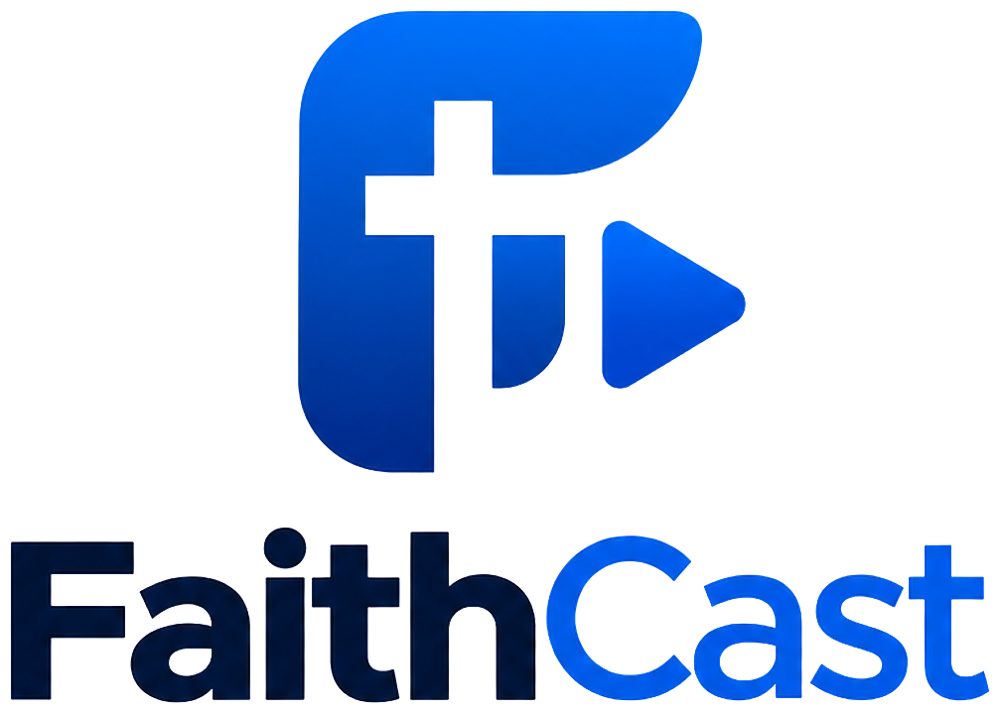

<p align="center"></p>

# FaithCast

Offline-first worship presentation software for macOS and Windows. Plan a service, prepare songs, Bible passages, media and slides, then run the whole service from one computer, with a separate full-screen output on a projector or TV.

> FaithCast was previously called WorshipFlow. On first launch it copies an existing WorshipFlow data folder (songs, services, Bibles, media, backups), and it still opens WorshipFlow files. See [DEVELOPMENT.md](DEVELOPMENT.md#renaming-the-app).

## Features

- **Service planner**: drag-and-drop running order with songs, Bible, images, video, audio, announcements, custom slides, sermon, offering, prayer and section headings. You can duplicate, rename, hide, lock and reorder items, and everything autosaves.
- **Live operator view**: service list, slide grid, a LIVE monitor, a NEXT monitor, large Previous/Next/Black/Clear/Logo/Pause/Exit controls, and video and audio transport.
- **Dual display**: automatic display detection with hot-plug support, borderless or native fullscreen on the selected display, a preview window when only one screen is connected, and an Identify-displays overlay.
- **Songs**: library with search across title, lyrics and author; section tags, arrangements, automatic slide splitting, and a live slide preview. Import `.song`, TXT (including CCLI SongSelect), JSON and OpenLyrics XML. Export `.song`, TXT, JSON and CSV.
- **Bible**: KJV and the Berean Standard Bible are installed, plus 12 more free English versions (public domain or open licence, from [thiagobodruk/bible](https://github.com/thiagobodruk/bible)) installable with one click. **Settings → Bibles** manages versions: install, import, set the default, remove. Book/chapter/verse browser, range selection, full-text search, recent and favourite passages. You can import other translations you are licensed to use: FaithCast JSON, thiagobodruk/bible JSON or XML, Zefania XML, or CSV.
- **Media**: images, video and audio with thumbnails, tags, folders, favourites and preview. Missing files are detected and can be relinked.
- **Internet**: built-in browser to find lyrics (highlight → import as a song), play YouTube videos full-screen on the projector, show or save web pictures, show or capture any page, and add web pages to a service. Pages run in an isolated sandbox.
- **Themes**: 8 original built-in themes (editable, with reset to original) plus your own, controlling fonts, colours, shadow and outline, a text box, text area, background (colour, gradient, image or video with blur, darken and overlay), transitions and logo. Import and export `.theme` files.
- **Custom slide builder**: text, images, video, shapes, lines and icons, with drag, resize, rotate, alignment guides, layers, undo/redo and a slide library.
- **Reliability**: SQLite with write-ahead logging (WAL) and full sync, daily automatic backups, one-click restore, crash detection with "resume presentation", recovery drafts for unsaved edits, error boundaries, and graceful handling of missing media.
- **Also included**: global ⌘K / Ctrl+K search, Quick Presentation, church branding, customisable shortcuts, light/dark/match-system appearance (operator UI only — the audience output is unaffected), UI scale, high-contrast mode, and in-app help.

## Install (packaged app)

**macOS**

1. Open `release/FaithCast-<version>-<arch>.dmg` and drag **FaithCast** to Applications.
2. The first launch is blocked because the development build isn't code-signed. Go to **System Settings → Privacy & Security → Open Anyway**.

**Windows**

1. Run `release/FaithCast-Setup-<version>.exe`. It installs for the current user (no administrator rights needed) and adds Start-menu and desktop shortcuts.
2. The installer isn't code-signed, so SmartScreen shows "Windows protected your PC". Click **More info → Run anyway**.

## Run from source

```bash
npm install
npm run dev          # start with hot reload
```

| Command | What it does |
|---|---|
| `npm run dev` | Run the app from source with hot reload: no build needed; uses its own data folder |
| `npm run dev:copy-data` | Copy the installed app's data into the dev data folder |
| `npm test` | Unit and database tests (Vitest) |
| `npm run test:e2e` | Builds, then drives the real app end to end (Playwright) |
| `npm run typecheck` | TypeScript checks for main and renderer |
| `npm run dist` | Builds the installer for the OS you're on into `release/` |
| `npm run dist:mac` / `npm run dist:win` | Builds the macOS `.dmg` / the Windows installer `.exe` (the Windows one also builds on a Mac) |

Requirements: macOS 11+ or Windows 10/11 (64-bit), Node.js 22+. No FFmpeg, Homebrew or internet connection is needed at runtime (except for the optional Internet section).

## Documentation

- [USER_GUIDE.md](USER_GUIDE.md): using FaithCast on a Sunday
- [KEYBOARD_SHORTCUTS.md](KEYBOARD_SHORTCUTS.md)
- [ARCHITECTURE.md](ARCHITECTURE.md): how it's built
- [DATABASE.md](DATABASE.md): schema, file formats, backup and recovery
- [DEVELOPMENT.md](DEVELOPMENT.md): building, testing, packaging, adding features, troubleshooting

## Known limitations

- **Code signing**: builds are unsigned until an Apple Developer ID / a Windows code-signing certificate is configured (see DEVELOPMENT.md).
- **Video formats**: playback uses Chromium and the OS's decoders (H.264, VP8/VP9, AV1; HEVC on macOS, and on Windows with Microsoft's HEVC Video Extensions). AVI/WMV must be converted to MP4 first (e.g. with HandBrake). FaithCast shows a clear message instead of failing silently.
- **Images on Windows**: HEIC and TIFF photos can't be converted on Windows; save them as JPEG or PNG first.
- **Bible translations**: only public-domain or openly licensed English versions are bundled. Others (NIV, ESV, etc.) must be imported by the church under its own licence.
